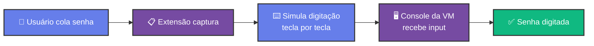
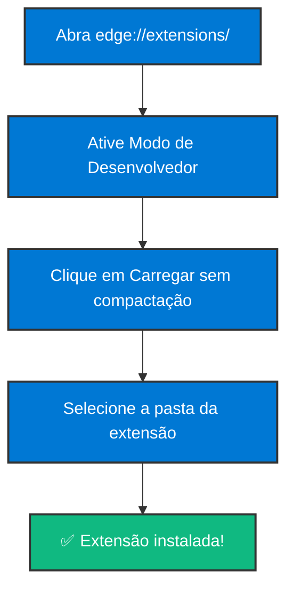
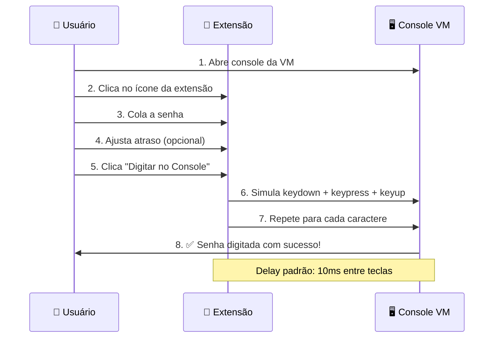
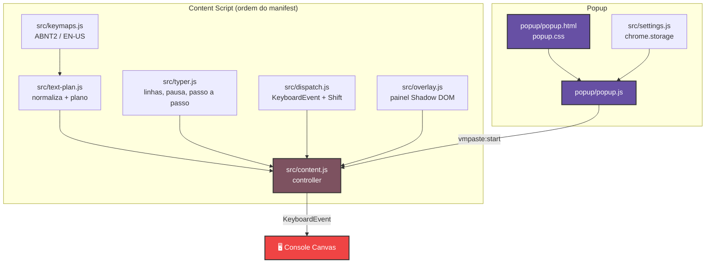

# 🔐 VMware Paste Helper

<div align="center">


**Extensão para navegador que simula digitação em consoles web de VMs**

[Instalação](#-instalação) • [Como Usar](#-como-usar) • [Funcionalidades](#-funcionalidades) • [Solução de Problemas](#-solução-de-problemas)

</div>

---

## 🎯 Sobre

Esta extensão resolve o problema de **não conseguir colar senhas e textos** em consoles web de máquinas virtuais (VMware vSphere, Proxmox, NoVNC, etc.) que não suportam área de transferência nativa.

### 💡 Como Funciona



### ✨ Funcionalidades

- ⌨️ **Teclado do destino ABNT2 ou EN-US** - escolha o layout da VM e `/`, `{`, `}`, `:` etc. chegam certos
- 🇧🇷 **Acentos no ABNT2** - `é`, `ã`, `ô`, `à`, `ü` digitados como acento + letra
- 📜 **Aba "Texto longo"** - comandos e scripts (bash, PowerShell) linha a linha
- 🪜 **Dois modos** - *Tudo de uma vez* (com pausa após cada Enter) ou *Passo a passo* (você confere e aperta Enter)
- 📊 **Painel de progresso na página** - pausar, retomar, cancelar e "Próxima linha"
- ⚠️ **Aviso antes de digitar** - lista caracteres que o layout escolhido não consegue enviar
- 🔒 **Campo de senha** oculto, pré-preenchido com a área de transferência
- 🎨 **Visual Material You** com tema claro e escuro automático
- 💾 **Preferências lembradas** (layout, atrasos, modo) - senha e texto nunca são salvos

---

## 📥 Instalação

### Microsoft Edge



1. **Abra o Microsoft Edge**
2. Digite `edge://extensions/` na barra de endereços
3. Ative o **"Modo de desenvolvedor"** (canto inferior esquerdo)
4. Clique em **"Carregar sem compactação"**
5. Navegue até `/home/{sua-pasta}/copy-paste-vm` e selecione a pasta

### Google Chrome

1. **Abra o Google Chrome**
2. Digite `chrome://extensions/` na barra de endereços
3. Ative o **"Modo do desenvolvedor"** (canto superior direito)
4. Clique em **"Carregar sem compactação"**
5. Navegue até a pasta da extensão e selecione

### Firefox (Temporário)

1. **Abra o Firefox**
2. Digite `about:debugging` na barra de endereços
3. Clique em **"Este Firefox"** no menu lateral
4. Clique em **"Carregar extensão temporária..."**
5. Selecione o arquivo `manifest.json`

---

## 🚀 Como Usar

### Fluxo de Uso



### Passo a Passo

1. **Acesse o console web** da sua VM (VMware, Proxmox, etc.) e clique dentro dele
2. **Clique no ícone** da extensão na barra de ferramentas
3. Escolha o **Teclado do destino**: `ABNT2` ou `EN-US` (o layout configurado na VM)
4. **Senha:** cole no campo (fica oculta por padrão)
   **Texto longo:** cole os comandos e escolha o modo:
   - **Tudo de uma vez** - digita linha, Enter, espera a *Pausa após Enter*, próxima linha
   - **Passo a passo** - digita uma linha e espera você apertar Enter no console (ou clicar *Próxima linha* no painel)
   - A **última linha nunca recebe Enter**: você confere e executa
5. **Ajuste o atraso** se necessário:
   - `10ms` - Conexões rápidas (padrão)
   - `50-100ms` - Se caracteres estiverem sendo perdidos
   - `100-200ms` - Conexões lentas ou VMs sobrecarregadas
6. Clique em **Digitar** (ou `Ctrl+Enter`). O popup fecha e o progresso aparece no canto da página

---

## 🛠️ Arquitetura



### Componentes

| Arquivo | Função |
|---------|--------|
| `manifest.json` | 📋 Configuração da extensão (Manifest V3) |
| `popup/` | 🎨 Interface (abas Senha / Texto longo, Material You) |
| `src/keymaps.js` | ⌨️ Mapas ABNT2 e EN-US, composição de acentos |
| `src/text-plan.js` | 🧹 Normaliza quebras de linha, detecta não suportados, monta o plano |
| `src/dispatch.js` | 🎹 Dispara eventos de teclado e controla o Shift |
| `src/typer.js` | ⏯️ Motor de digitação (modos, pausa, cancelamento) |
| `src/overlay.js` | 📊 Painel de progresso injetado na página |
| `src/content.js` | 🔌 Recebe a mensagem do popup e conduz a digitação |
| `src/settings.js` | 💾 Preferências salvas |
| `tests/` | ✅ Testes (`node --test`) |
| `icons/` | 🎨 Ícones da extensão |

### 🧪 Testes

Sem dependências: usa o test runner nativo do Node.

```bash
node --test
```

---

## 🔧 Solução de Problemas

### ❓ Caracteres estão sendo perdidos?

**Solução:** Aumente o valor do "Atraso" no popup:
- Comece com `50ms`
- Se persistir, tente `100ms` ou mais

### ❓ Nada acontece ao clicar?

**Solução:**
1. Clique dentro da tela do console da VM **antes** de usar a extensão
2. Recarregue a página do console
3. Verifique o console do navegador (F12) por erros

### ❓ Caracteres saem trocados (ex.: `/` some, `}` vira `|`)?

**Solução:** o **Teclado do destino** não bate com o layout configurado na VM. Troque entre `ABNT2` e `EN-US`.

### ❓ Alguns caracteres especiais não funcionam?

**Solução:**
- O aviso antes de digitar lista o que o layout escolhido não suporta (ex.: acentos e `ç` no EN-US)
- Ao confirmar, esses caracteres são pulados

### ❓ A extensão não aparece na barra?

**Solução:**
1. Verifique se o modo desenvolvedor está ativado
2. Recarregue a extensão em `edge://extensions/`
3. Fixe a extensão clicando no ícone de puzzle 🧩

---

## 🎯 Casos de Uso

- ✅ **VMware vSphere** Web Console
- ✅ **Proxmox VE** noVNC Console
- ✅ **KVM/QEMU** Web Console
- ✅ **OpenStack** Horizon Console
- ✅ **Amazon EC2** Serial Console
- ✅ Qualquer console web baseado em Canvas/VNC

---

## 📊 Compatibilidade

| Navegador | Versão Mínima | Status |
|-----------|---------------|--------|
| Microsoft Edge | 88+ | ✅ Testado |
| Google Chrome | 88+ | ✅ Compatível |
| Firefox | 109+ | ⚠️ Temporário apenas |

---

## 📝 Notas Técnicas

### Simulação de Teclado

Os mapas enviam o `code`/`keyCode` da **tecla física** do layout escolhido (consoles como o VMware traduzem isso em scancode). Sequência por tecla:

```javascript
keydown → keypress → input → keyup
```

Shift é pressionado/solto só na transição entre caracteres com e sem Shift. No ABNT2, acentos são dead key + letra (`´` + `e` → `é`); uma dead key isolada (`~`, `^`) é seguida de espaço para não combinar com a próxima letra.

### Texto Longo

- `\r\n` (Windows) conta como um Enter só; uma quebra de linha no final é removida
- Enter entre linhas, nunca após a última
- No passo a passo, o Enter **real** do usuário (`isTrusted`) libera a próxima linha

### Detecção de Alvo

Prioridade de detecção do elemento:
1. `document.activeElement` (elemento com foco)
2. `document.querySelector('canvas')` (canvas do console)
3. `document.body` (fallback)

---

## 📄 Licença

MIT License - Sinta-se livre para usar, modificar e distribuir.

---

<div align="center">

**Desenvolvido com 💜 para facilitar o trabalho com VMs**

[⬆ Voltar ao topo](#-vmware-paste-helper)

</div>
